<!-- refreshed: 2026-11-24 | github-graphql -->
<!-- Profile README. All cards are generated SVGs; edit scripts/content.py, then run `python generate_cards.py`. -->

 

 

 

 

 

 

<a href="https://seedcode-cli.vercel.app/">Official website</a> &nbsp;·&nbsp; <a href="https://github.com/Alshahriar-07/seedcode-cli">GitHub repository</a>

 

 

 

 

 

 

 

 

 

<a href="mailto:alshahriarsayon425@gmail.com">Email</a> &nbsp;·&nbsp; <a href="https://alshahriarsayon.vercel.app/">Portfolio</a> &nbsp;·&nbsp; <a href="https://github.com/Alshahriar-07">GitHub</a> &nbsp;·&nbsp; <a href="https://www.linkedin.com/in/alshahriarsowan">LinkedIn</a> &nbsp;·&nbsp; <a href="./assets/me_ascii.svg">ASCII portrait</a> &nbsp;·&nbsp; <a href="https://github.com/Alshahriar-07/seedcode-cli">SeedCode CLI source</a>

EAGOX Studio · Gazipur, Bangladesh · Cards rendered with Python and SVG, refreshed daily by GitHub Actions.

